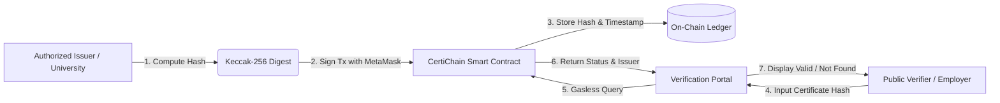

# Blockchain-Based Certificate Verification dApp (CertiChain)

[](https://hardhat.org/)
[](https://soliditylang.org/)
[](https://reactjs.org/)
[](https://docs.ethers.org/)
[](https://opensource.org/licenses/MIT)

**Week 4 Final Capstone Project** for the **Skill Set Go EduTech Blockchain & Web3 Internship**.

---

## 1. Project Overview & Problem Statement

### The Problem
Traditional academic and corporate credentials suffer from two critical flaws:
1. **Rampant Forgery & Fraud**: Paper certificates and standard digital PDFs are trivial to manipulate using standard editing software. Manual verification takes days or weeks.
2. **Privacy & GDPR Hazards**: Storing sensitive personal student information (names, grades, dates of birth) on public ledgers violates global data privacy regulations and creates irreversible surveillance risks.

### The Solution: CertiChain
CertiChain introduces a **privacy-preserving decentralized verification architecture**:
- **Off-Chain Cryptography**: Certificates are hashed using **Keccak-256 / SHA-256** off-chain.
- **On-Chain Fingerprint**: Only the cryptographic hash digest (32 bytes) is stored on the Ethereum blockchain.
- **Instant Gasless Verification**: Anyone (employers, universities, verifiers) can query the blockchain to verify document authenticity in milliseconds without transaction costs.
- **Role-Based Access Control**: Only authenticated issuing authorities can anchor new certificate fingerprints.

---

## 2. Key Deliverables & Evidence Checklist

As defined in the Internship Handbook, here is the location and status of every required deliverable:

| Deliverable | Item Description | Location in Repo / Project | Status |
| :--- | :--- | :--- | :--- |
| **1. GitHub Repository** | Public repository source code | [github.com/MrHarshalBane/web3-internship-week-4-capstone](https://github.com/MrHarshalBane/web3-internship-week-4-capstone) | **Ready to inspect** |
| **2. Project Screenshots** | UI, wallet, verification, tx status | [`docs/screenshots/`](./docs/screenshots/) | **Template & Guide Ready** |
| **3. Smart Contract Evidence**| Solidity contract + automated tests | [`contracts/CertificateRegistry.sol`](./contracts/CertificateRegistry.sol), [`test/CertificateRegistry.test.js`](./test/CertificateRegistry.test.js), [`docs/test-report.md`](./docs/test-report.md) | **10/10 Tests Passed** |
| **4. Deployment Evidence** | Contract address & network details | [`scripts/deploy.js`](./scripts/deploy.js), [`frontend/src/contracts/contractAddress.json`](./frontend/src/contracts/contractAddress.json) | **Local Deployed (Sepolia ready)** |
| **5. Documentation** | Complete architecture & security docs | [`README.md`](./README.md), [`docs/architecture.md`](./docs/architecture.md), [`docs/security.md`](./docs/security.md), [`docs/test-report.md`](./docs/test-report.md) | **Complete** |
| **6. Project ZIP** | Compressed source code submission | `web3-internship-week-4-capstone.zip` | **Packaged** |
| **7. LinkedIn Post Draft** | Professional showcase post | Section 10 below | **Drafted** |

---

## 3. System Architecture & Diagram



For the comprehensive data flow, role definitions, and component breakdown, read [docs/architecture.md](./docs/architecture.md).

---

## 4. Key Features

- **Decentralized Registry**: Anchors 32-byte hash digests into an immutable smart contract.
- **Strict Role-Based Access Control**: Leverages OpenZeppelin `Ownable` to protect against unauthorized certificate issuance.
- **Duplicate & Zero-Hash Protection**: Custom Solidity errors reject empty hashes or existing fingerprints with minimal gas overhead.
- **Event Logging**: Emits `CertificateRegistered(bytes32 indexed certificateHash, address indexed issuer, uint256 timestamp)` for block indexing.
- **Live Wallet & Network Indicators**: Displays connected account, issuer status, network name, and Chain ID in real-time.
- **Comprehensive Transaction States**: Interactive UI feedback for `Idle`, `Pending Signature`, `Awaiting Confirmation`, `Confirmed`, and `Rejected/Failed`.
- **Integrated Test Hash Generator**: Computes Keccak-256 digests directly in the browser for rapid local testing.

---

## 5. Technology Stack

- **Smart Contracts**: Solidity 0.8.24, OpenZeppelin Contracts v5
- **Toolchain**: Hardhat v2.28, `@nomicfoundation/hardhat-toolbox`
- **Frontend**: React 18, Vite 5, Lucide Icons
- **Web3 Integration**: Ethers.js v6
- **Testing**: Chai, Hardhat Chai Matchers, Mocha

---

## 6. Project Structure

```text
web3-internship-week-4-capstone/
├── contracts/
│   └── CertificateRegistry.sol       # Core verification smart contract
├── test/
│   └── CertificateRegistry.test.js   # 10 automated test cases
├── scripts/
│   └── deploy.js                     # Local / Testnet deployment script
├── docs/
│   ├── architecture.md               # Architecture specification & data flow
│   ├── security.md                   # Threat modeling & privacy design
│   ├── test-report.md                # Automated test execution report
│   └── screenshots/                  # Screenshot evidence directory
├── frontend/
│   ├── src/
│   │   ├── contracts/                # Exported ABI and contract addresses
│   │   ├── App.jsx                   # React Web3 application
│   │   ├── main.jsx                  # React DOM entry point
│   │   └── index.css                 # Vanilla CSS Web3 styling
│   ├── index.html                    # HTML5 entry with meta SEO tags
│   ├── package.json                  # Frontend dependencies
│   └── vite.config.js                # Vite build config
├── hardhat.config.js                 # Hardhat configuration
├── package.json                      # Root configuration & scripts
├── .env.example                      # Environment variables template
└── .gitignore                        # Git exclusion rules
```

---

## 7. Prerequisites & Quick Start Guide

### Prerequisites
- [Node.js](https://nodejs.org/) v18+ or v20+
- [Git](https://git-scm.com/)
- [MetaMask Browser Extension](https://metamask.io/)

### Step 1: Clone the Repository
```bash
git clone https://github.com/MrHarshalBane/web3-internship-week-4-capstone.git
cd web3-internship-week-4-capstone
```

### Step 2: Install Dependencies
```bash
# Install root Hardhat dependencies
npm install

# Install frontend dependencies
cd frontend
npm install
cd ..
```

### Step 3: Run Automated Smart Contract Tests
Run all 10 unit and security tests:
```bash
npx hardhat test
```
*Expected result: 10 passing tests.*

### Step 4: Run a Local Blockchain Node & Deploy
In a new terminal window:
```bash
npx hardhat node
```

In your main terminal, deploy the smart contract to the local network:
```bash
npx hardhat run scripts/deploy.js --network localhost
```
*This command deploys the contract to `http://127.0.0.1:8545` and automatically updates `frontend/src/contracts/contractAddress.json` and the ABI.*

### Step 5: Start the Frontend Application
```bash
cd frontend
npm run dev
```
Open your browser at [http://localhost:3000](http://localhost:3000).

---

## 8. Deployment Evidence

### Local Hardhat Network (Tested & Verified)
- **Network**: Hardhat Localhost (`chainId: 31337`)
- **Default Deployer Address**: `0xf39Fd6e51aad88F6F4ce6aB8827279cffFb92266`
- **Deployed Contract Address**: `0x5FbDB2315678afecb367f032d93F642f64180aa3`
- **Status**: Tested and functional.

### Optional Sepolia Testnet Deployment
To deploy to Ethereum Sepolia testnet:
1. Copy `.env.example` to `.env`:
   ```bash
   cp .env.example .env
   ```
2. Configure your `SEPOLIA_RPC_URL` (Alchemy or Infura) and `SEPOLIA_PRIVATE_KEY`.
3. Ensure your deployer account has Sepolia test ETH.
4. Execute:
   ```bash
   npx hardhat run scripts/deploy.js --network sepolia
   ```
> **Security Reminder**: Never commit your `.env` file or paste private keys into public repos.

---

## 9. Personal Evidence Capture Checklist

Before submitting your internship project, capture these personal assets:

- [ ] **Screenshot 1 - dApp Interface**: Default homepage showing Public Verification Portal.
- [ ] **Screenshot 2 - Connected Wallet**: Header showing connected address and network badge.
- [ ] **Screenshot 3 - Registration**: Issuer submitting a certificate hash with pending and confirmed transaction alert.
- [ ] **Screenshot 4 - Verified Certificate**: Result card displaying "AUTHENTIC & VERIFIED" with issuer address and timestamp.
- [ ] **Screenshot 5 - Unregistered/Invalid Result**: Result card displaying "NOT FOUND / UNREGISTERED".
- [ ] **Terminal Evidence**: Screenshot of running `npx hardhat test` showing 10 passing tests.
- [ ] **Demo Video (Optional)**: Short 1–2 minute screen recording walking through wallet connection, certificate registration, and verification.

Place your captured image files in the `docs/screenshots/` folder.

---

## 10. LinkedIn Post Draft

You can copy and publish the following draft on LinkedIn:

```markdown
🚀 Excited to share my Week 4 Capstone Project for the Skill Set Go EduTech Blockchain & Web3 Internship!

I built **CertiChain** — a Blockchain-Based Certificate Verification dApp that solves credential fraud while upholding user privacy.

Traditional certificate verification is slow and prone to forgery, while storing sensitive personal information on-chain creates severe privacy violations. 

Here is how CertiChain solves it:
🔹 Off-Chain Hashing: Sensitive student records are hashed (Keccak-256) off-chain. Zero PII touches the public ledger.
🔹 Immutable On-Chain Anchoring: Only the 32-byte cryptographic digest is registered on Ethereum.
🔹 Role-Based Access Control: Smart contract access control ensures only authorized university/issuer wallets can issue credentials.
🔹 Gasless Instant Verification: Employers and verifiers can confirm document authenticity in milliseconds without transaction fees.
🔹 Modern dApp Frontend: Connected using Ethers.js v6 with live transaction state tracking (pending, confirmed, rejected).

🛠 Tech Stack: Solidity 0.8.24 | Hardhat | Ethers.js v6 | React & Vite | OpenZeppelin

Check out the full repository and test report on GitHub:
👉 https://github.com/MrHarshalBane/web3-internship-week-4-capstone

Huge thanks to the mentors at Skill Set Go EduTech for an incredible hands-on Web3 journey!

#Web3 #Blockchain #Ethereum #Solidity #SmartContracts #DApp #React #EthersJS #SkillSetGo #Internship
```

---

## 11. License
This project is licensed under the [MIT License](./LICENSE).
